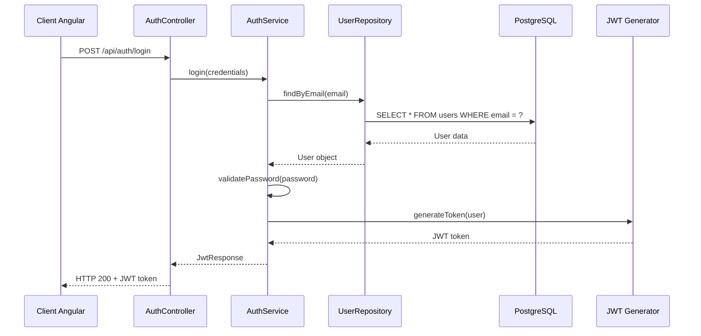
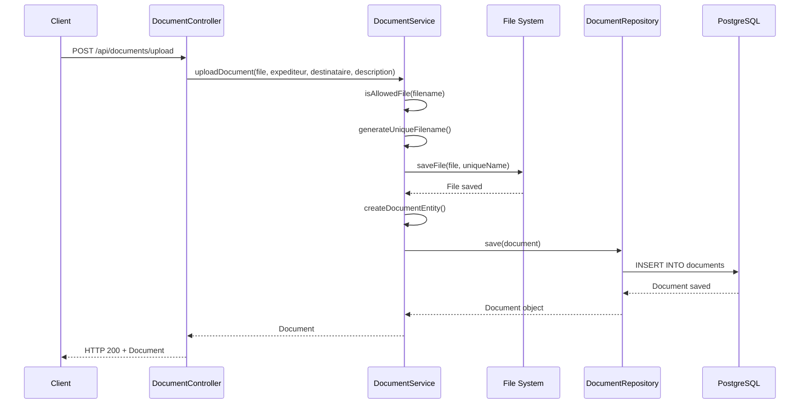
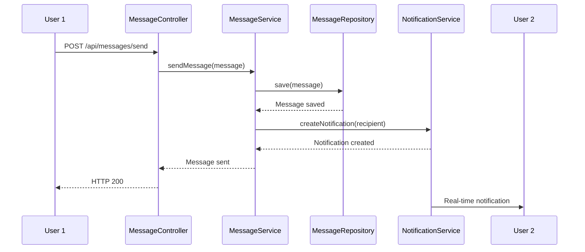

# 📊 Diagrammes d'Architecture - Portail Cabinet Comptable

## 🏗️ Architecture Globale

```
┌─────────────────────────────────────────────────────────────────────────────┐
│                           PORTAL CABINET COMPTABLE                          │
├─────────────────────────────────────────────────────────────────────────────┤
│                                                                             │
│  ┌─────────────────┐    ┌─────────────────┐    ┌─────────────────┐        │
│  │   Frontend      │    │   Backend       │    │   Base de       │        │
│  │   Angular       │◄──►│   Spring Boot   │◄──►│   Données       │        │
│  │   (UI/UX)       │    │   (API REST)    │    │   PostgreSQL    │        │
│  └─────────────────┘    └─────────────────┘    └─────────────────┘        │
│           │                       │                       │                │
│           │                       ▼                       │                │
│           │              ┌─────────────────┐              │                │
│           │              │   Système de    │              │                │
│           │              │   Fichiers      │              │                │
│           │              │   (Uploads)     │              │                │
│           │              └─────────────────┘              │                │
│           │                       │                       │                │
│           └───────────────────────┼───────────────────────┘                │
│                                   │                                        │
│                                   ▼                                        │
│                        ┌─────────────────┐                                 │
│                        │   IA ChatBot    │                                 │
│                        │   (Analyse)     │                                 │
│                        └─────────────────┘                                 │
└─────────────────────────────────────────────────────────────────────────────┘
```

## 🔄 Flux d'Authentification



## 📁 Upload de Document



## 💬 Système de Messagerie



## 🏛️ Architecture des Couches

```
┌─────────────────────────────────────────────────────────────────────────────┐
│                              LAYER ARCHITECTURE                             │
├─────────────────────────────────────────────────────────────────────────────┤
│                                                                             │
│  ┌─────────────────────────────────────────────────────────────────────┐   │
│  │                    PRESENTATION LAYER                              │   │
│  │  ┌─────────────┐ ┌─────────────┐ ┌─────────────┐ ┌─────────────┐   │   │
│  │  │AuthController│ │UserController│ │DocController│ │MsgController│   │   │
│  │  └─────────────┘ └─────────────┘ └─────────────┘ └─────────────┘   │   │
│  └─────────────────────────────────────────────────────────────────────┘   │
│                                    │                                       │
│                                    ▼                                       │
│  ┌─────────────────────────────────────────────────────────────────────┐   │
│  │                     BUSINESS LAYER                                 │   │
│  │  ┌─────────────┐ ┌─────────────┐ ┌─────────────┐ ┌─────────────┐   │   │
│  │  │ AuthService │ │ UserService │ │ DocService  │ │ MsgService  │   │   │
│  │  └─────────────┘ └─────────────┘ └─────────────┘ └─────────────┘   │   │
│  └─────────────────────────────────────────────────────────────────────┘   │
│                                    │                                       │
│                                    ▼                                       │
│  ┌─────────────────────────────────────────────────────────────────────┐   │
│  │                     DATA ACCESS LAYER                              │   │
│  │  ┌─────────────┐ ┌─────────────┐ ┌─────────────┐ ┌─────────────┐   │   │
│  │  │UserRepository│ │DocRepository│ │MsgRepository│ │NotifRepository│   │   │
│  │  └─────────────┘ └─────────────┘ └─────────────┘ └─────────────┘   │   │
│  └─────────────────────────────────────────────────────────────────────┘   │
│                                    │                                       │
│                                    ▼                                       │
│  ┌─────────────────────────────────────────────────────────────────────┐   │
│  │                      DATABASE LAYER                                │   │
│  │                        PostgreSQL                                  │   │
│  └─────────────────────────────────────────────────────────────────────┘   │
└─────────────────────────────────────────────────────────────────────────────┘
```

## 🔐 Architecture de Sécurité

```
┌─────────────────────────────────────────────────────────────────────────────┐
│                           SECURITY ARCHITECTURE                            │
├─────────────────────────────────────────────────────────────────────────────┤
│                                                                             │
│  ┌─────────────────┐    ┌─────────────────┐    ┌─────────────────┐        │
│  │   Client        │    │   Spring        │    │   JWT Token     │        │
│  │   (Angular)     │───►│   Security      │───►│   Validation    │        │
│  └─────────────────┘    └─────────────────┘    └─────────────────┘        │
│           │                       │                       │                │
│           │                       ▼                       │                │
│           │              ┌─────────────────┐              │                │
│           │              │   Role-Based    │              │                │
│           │              │   Access        │              │                │
│           │              │   Control       │              │                │
│           │              └─────────────────┘              │                │
│           │                       │                       │                │
│           └───────────────────────┼───────────────────────┘                │
│                                   │                                        │
│                                   ▼                                        │
│                        ┌─────────────────┐                                 │
│                        │   Protected      │                                 │
│                        │   Endpoints      │                                 │
│                        └─────────────────┘                                 │
└─────────────────────────────────────────────────────────────────────────────┘
```

## 📊 Structure de Base de Données

```
┌─────────────────────────────────────────────────────────────────────────────┐
│                        DATABASE SCHEMA                                     │
├─────────────────────────────────────────────────────────────────────────────┤
│                                                                             │
│  ┌─────────────┐    ┌─────────────┐    ┌─────────────┐                    │
│  │    users    │    │  documents  │    │   messages  │                    │
│  │             │    │             │    │             │                    │
│  │ id (PK)     │    │ id (PK)     │    │ id (PK)     │                    │
│  │ email       │    │ nom_fichier │    │ expediteur  │                    │
│  │ mot_de_passe│    │ chemin_fich │    │ destinataire│                    │
│  │ nom         │    │ type        │    │ contenu     │                    │
│  │ prenom      │    │ statut      │    │ statut      │                    │
│  │ role        │    │ expediteur  │    │ date_envoi  │                    │
│  │ enabled     │    │ destinataire│    │ lu          │                    │
│  │ date_creation│   │ taille_fich │    └─────────────┘                    │
│  └─────────────┘    │ description │                                       │
│                     │ date_depot  │    ┌─────────────┐                    │
│                     └─────────────┘    │notifications│                    │
│                                        │             │                    │
│  ┌─────────────┐    ┌─────────────┐    │ id (PK)     │                    │
│  │  chatbot_ai │    │   roles     │    │ destinataire│                    │
│  │             │    │             │    │ type        │                    │
│  │ id (PK)     │    │ id (PK)     │    │ contenu     │                    │
│  │ user        │    │ nom         │    │ lu          │                    │
│  │ question    │    │ description │    │ date_creation│                   │
│  │ reponse     │    │ permissions │    └─────────────┘                    │
│  │ type_analyse│    └─────────────┘                                       │
│  │ date_creation│                                                          │
│  └─────────────┘                                                          │
└─────────────────────────────────────────────────────────────────────────────┘
```

## 🔄 Flux de Données

```
┌─────────────────────────────────────────────────────────────────────────────┐
│                           DATA FLOW                                        │
├─────────────────────────────────────────────────────────────────────────────┤
│                                                                             │
│  1. REQUEST FLOW:                                                          │
│     Client → Controller → Service → Repository → Database                  │
│                                                                             │
│  2. RESPONSE FLOW:                                                         │
│     Database → Repository → Service → Controller → Client                  │
│                                                                             │
│  3. VALIDATION FLOW:                                                       │
│     Input → DTO Validation → Business Rules → Database Constraints         │
│                                                                             │
│  4. ERROR FLOW:                                                            │
│     Exception → Exception Handler → Error Response → Client                │
└─────────────────────────────────────────────────────────────────────────────┘
```

## 🎯 Points d'Intégration

```
┌─────────────────────────────────────────────────────────────────────────────┐
│                        INTEGRATION POINTS                                  │
├─────────────────────────────────────────────────────────────────────────────┤
│                                                                             │
│  ┌─────────────────┐    ┌─────────────────┐    ┌─────────────────┐        │
│  │   Frontend      │    │   Backend       │    │   External      │        │
│  │   Integration   │◄──►│   API Gateway   │◄──►│   Services      │        │
│  │                 │    │                 │    │                 │        │
│  │ • Angular HTTP  │    │ • REST Endpoints│    │ • Email Service │        │
│  │ • WebSocket     │    │ • JWT Auth      │    │ • File Storage  │        │
│  │ • Real-time     │    │ • CORS Config   │    │ • AI Services   │        │
│  └─────────────────┘    └─────────────────┘    └─────────────────┘        │
│           │                       │                       │                │
│           │                       ▼                       │                │
│           │              ┌─────────────────┐              │                │
│           │              │   Database      │              │                │
│           │              │   Integration   │              │                │
│           │              │                 │              │                │
│           │              │ • PostgreSQL    │              │                │
│           │              │ • JPA/Hibernate │              │                │
│           │              │ • Connection    │              │                │
│           │              │   Pool          │              │                │
│           │              └─────────────────┘              │                │
└─────────────────────────────────────────────────────────────────────────────┘
```

---

*Diagrammes générés pour le projet Portail Cabinet Comptable - Version 1.0* 