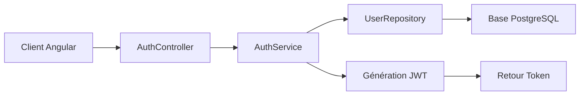
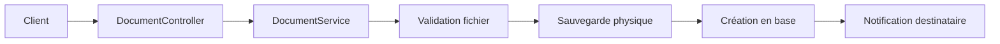
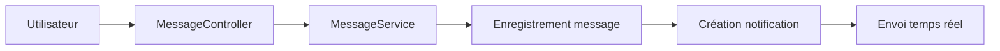

# 🏢 Architecture et Rôle des Dossiers - Portail Cabinet Comptable

## 📋 Table des Matières
1. [Logique Métier de l'Application](#logique-métier-de-lapplication)
2. [Architecture et Rôle des Dossiers](#architecture-et-rôle-des-dossiers)
3. [Flux Métier Principaux](#flux-métier-principaux)
4. [Variables et Configurations Clés](#variables-et-configurations-clés)
5. [Prochaines Étapes de Développement](#prochaines-étapes-de-développement)

---

## 🏢 Logique Métier de l'Application

### **Contexte et Objectifs**
Votre application est un **portail digital** pour un cabinet comptable qui vise à :
- **Digitaliser les échanges** entre le cabinet et ses clients
- **Centraliser la communication** et la gestion documentaire
- **Intégrer l'IA** pour l'analyse automatique des documents
- **Fournir un tableau de bord** administratif complet

---

## 📁 Architecture et Rôle des Dossiers

### **1. Structure Générale Maven**
```
portail-cabinet-comptable/
├── src/
│   ├── main/
│   │   ├── java/com/cabinet/portail/    # Code source Java
│   │   └── resources/                   # Configuration
│   └── test/                            # Tests unitaires
└── pom.xml                              # Dépendances Maven
```

### **2. Package `com.cabinet.portail` - Organisation Modulaire**

#### **🏗️ `entity/` - Modèle de Données**
**Rôle :** Définit la structure des données en base de données

**Entités principales :**
- **`User`** : Utilisateurs (clients, comptables, administrateurs)
- **`Document`** : Documents déposés et partagés
- **`Message`** : Système de messagerie interne
- **`Notification`** : Notifications en temps réel
- **`ChatBotAI`** : Historique des interactions IA

**Variables importantes :**
```java
// User.java
private String email;           // Identifiant unique
private String motDePasse;      // Hashé avec BCrypt
private UserRole role;          // CLIENT, COMPTABLE, ADMIN
private boolean enabled;        // Compte actif/inactif

// Document.java
private String nomFichier;      // Nom original du fichier
private String cheminFichier;   // Chemin physique sur le serveur
private DocumentStatut statut;  // DEPOSE, VALIDE, REJETE
private Long tailleFichier;     // Taille en bytes
```

#### **📦 `repository/` - Couche d'Accès aux Données**
**Rôle :** Interface avec la base de données PostgreSQL

**Repositories :**
- **`UserRepository`** : Gestion des utilisateurs
- **`DocumentRepository`** : Gestion des documents
- **`MessageRepository`** : Gestion des messages
- **`NotificationRepository`** : Gestion des notifications
- **`ChatBotRepository`** : Gestion de l'historique IA

**Méthodes importantes :**
```java
// UserRepository.java
findByEmail(String email)           // Authentification
findByRole(UserRole role)           // Filtrage par rôle
existsByEmail(String email)         // Vérification unicité

// DocumentRepository.java
findByUser(User user)               // Documents d'un utilisateur
findByStatut(DocumentStatut statut) // Documents par statut
findNonTraites()                    // Documents en attente
```

#### **📦 `service/` - Logique Métier**
**Rôle :** Contient la logique métier et les règles de gestion

**Services principaux :**
- **`AuthService`** : Authentification JWT et gestion des tokens
- **`UserService`** : Gestion des utilisateurs et profils
- **`DocumentService`** : Upload, téléchargement, validation
- **`MessageService`** : Système de messagerie
- **`NotificationService`** : Notifications temps réel
- **`ChatBotService`** : Intégration IA

**Logique métier clé :**
```java
// AuthServiceImpl.java
public JwtResponse login(LoginRequest request) {
    // 1. Vérifier les credentials
    // 2. Générer JWT token
    // 3. Retourner réponse avec token
}

// DocumentServiceImpl.java
public Document uploadDocument(MultipartFile file, User expediteur, User destinataire, String description) {
    // 1. Valider le type de fichier
    // 2. Générer nom unique
    // 3. Sauvegarder physiquement
    // 4. Créer enregistrement en base
}
```

#### **📦 `controller/` - API REST**
**Rôle :** Expose les endpoints HTTP pour le frontend Angular

**Controllers :**
- **`AuthController`** : `/api/auth/*` - Authentification
- **`UserController`** : `/api/users/*` - Gestion utilisateurs
- **`DocumentController`** : `/api/documents/*` - Gestion documents
- **`MessageController`** : `/api/messages/*` - Messagerie
- **`NotificationController`** : `/api/notifications/*` - Notifications
- **`ChatBotController`** : `/api/chatbot/*` - IA
- **`AdminController`** : `/api/admin/*` - Tableau de bord

**Endpoints clés :**
```java
// AuthController.java
POST /api/auth/login          // Connexion
POST /api/auth/register       // Inscription
POST /api/auth/refresh        // Renouvellement token

// DocumentController.java
POST /api/documents/upload    // Upload document
GET /api/documents/download/{id}  // Téléchargement
PUT /api/documents/{id}/validate  // Validation
```

#### **📦 `dto/` - Objets de Transfert**
**Rôle :** Définit les structures de données pour les échanges API

**Structure :**
```
dto/
├── request/     # Données d'entrée (login, upload, etc.)
└── response/    # Données de sortie (JWT, documents, etc.)
```

**Exemples :**
```java
// LoginRequest.java
public class LoginRequest {
    @NotBlank
    private String email;
    @NotBlank
    private String password;
}

// JwtResponse.java
public class JwtResponse {
    private String token;
    private String type;
    private Long id;
    private String nom;
    private String email;
    private UserRole role;
}
```

#### **🔒 `security/` - Sécurité**
**Rôle :** Configuration Spring Security et JWT

**Composants :**
- **Configuration JWT** : Génération/validation des tokens
- **Spring Security** : Protection des endpoints
- **CORS** : Configuration cross-origin pour Angular

#### **⚙️ `config/` - Configuration**
**Rôle :** Configuration globale de l'application

**Configurations :**
- **Base de données** : Connexion PostgreSQL
- **JPA/Hibernate** : Mapping objets-relationnel
- **Multipart** : Gestion des uploads de fichiers
- **CORS** : Configuration pour le frontend

#### **⚠️ `exception/` - Gestion d'Erreurs**
**Rôle :** Gestion centralisée des exceptions

**Types d'exceptions :**
- **ValidationException** : Erreurs de validation
- **AuthenticationException** : Erreurs d'authentification
- **DocumentException** : Erreurs liées aux documents

#### **🛠️ `util/` - Utilitaires**
**Rôle :** Classes utilitaires réutilisables

**Utilitaires :**
- **DateUtils** : Manipulation des dates
- **FileUtils** : Utilitaires pour les fichiers
- **ValidationUtils** : Validation personnalisée

---

## 🔄 Flux Métier Principaux

### **1. Authentification et Autorisation**


### **2. Upload de Document**


### **3. Système de Messagerie**


---

## 🎯 Variables et Configurations Clés

### **Configuration `application.yml`**
```yaml
# Base de données
spring:
  datasource:
    url: jdbc:postgresql://localhost:5432/portail_cabinet
    username: postgres
    password: password

# JWT
jwt:
  secret: votre_secret_jwt_tres_securise
  expiration: 86400000  # 24h en ms

# Upload de fichiers
file:
  upload-dir: ./uploads/documents
  max-size: 10MB
```

### **Variables d'Environnement**
- **`uploadDir`** : Répertoire de stockage des fichiers
- **`jwtSecret`** : Clé secrète pour signer les JWT
- **`jwtExpiration`** : Durée de validité des tokens

### **Statuts et Énumérations**
```java
// Statuts des documents
enum DocumentStatut {
    DEPOSE,     // Document déposé, en attente
    VALIDE,     // Document validé par le comptable
    REJETE      // Document rejeté
}

// Rôles utilisateurs
enum UserRole {
    CLIENT,     // Client du cabinet
    COMPTABLE,  // Comptable du cabinet
    ADMIN       // Administrateur système
}
```

---

## 🚀 Prochaines Étapes de Développement

1. **Configuration Spring Security** pour protéger les endpoints
2. **Implémentation des services manquants** (Message, Notification, ChatBot)
3. **Création des controllers restants**
4. **Gestion des exceptions centralisée**
5. **Tests unitaires et d'intégration**
6. **Documentation API avec Swagger**

---

## 📊 Diagramme d'Architecture

```
┌─────────────────┐    ┌─────────────────┐    ┌─────────────────┐
│   Frontend      │    │   Backend       │    │   Base de       │
│   Angular       │◄──►│   Spring Boot   │◄──►│   Données       │
│                 │    │                 │    │   PostgreSQL    │
└─────────────────┘    └─────────────────┘    └─────────────────┘
                              │
                              ▼
                       ┌─────────────────┐
                       │   Système de    │
                       │   Fichiers      │
                       │   (Uploads)     │
                       └─────────────────┘
```

---

## 🔧 Technologies Utilisées

### **Backend**
- **Spring Boot 3.2+** : Framework principal
- **Java 17** : Langage de programmation
- **PostgreSQL** : Base de données relationnelle
- **JWT** : Authentification et autorisation
- **Spring Security** : Sécurité des endpoints
- **Spring Data JPA** : Accès aux données
- **Maven** : Gestion des dépendances

### **Frontend (à développer)**
- **Angular** : Framework frontend
- **TypeScript** : Langage de programmation
- **Bootstrap/Material** : Interface utilisateur

### **Outils de Développement**
- **VS Code/Cursor** : Éditeur de code
- **Extension Pack for Java** : Support Java
- **Spring Boot Tools** : Outils Spring Boot

---

## 📝 Notes de Développement

Cette architecture suit les **bonnes pratiques Spring Boot** avec :
- ✅ **Séparation des responsabilités** (MVC)
- ✅ **Injection de dépendances** (DI)
- ✅ **Gestion d'erreurs centralisée**
- ✅ **Validation des données**
- ✅ **Documentation du code**
- ✅ **Architecture modulaire**

---

*Documentation générée pour le projet Portail Cabinet Comptable - Version 1.0* 