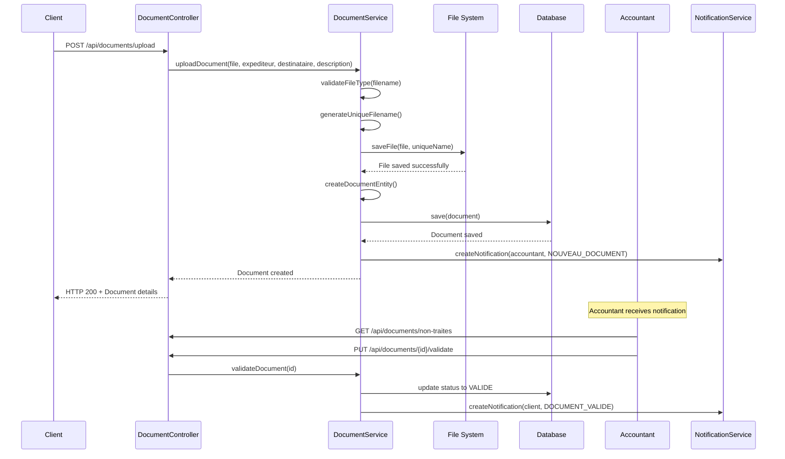
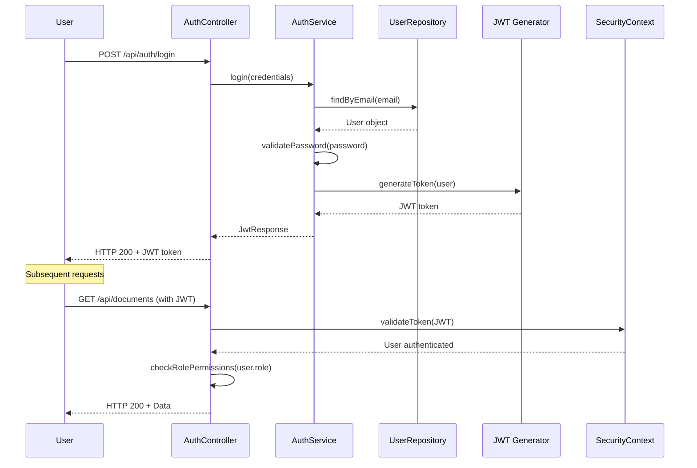
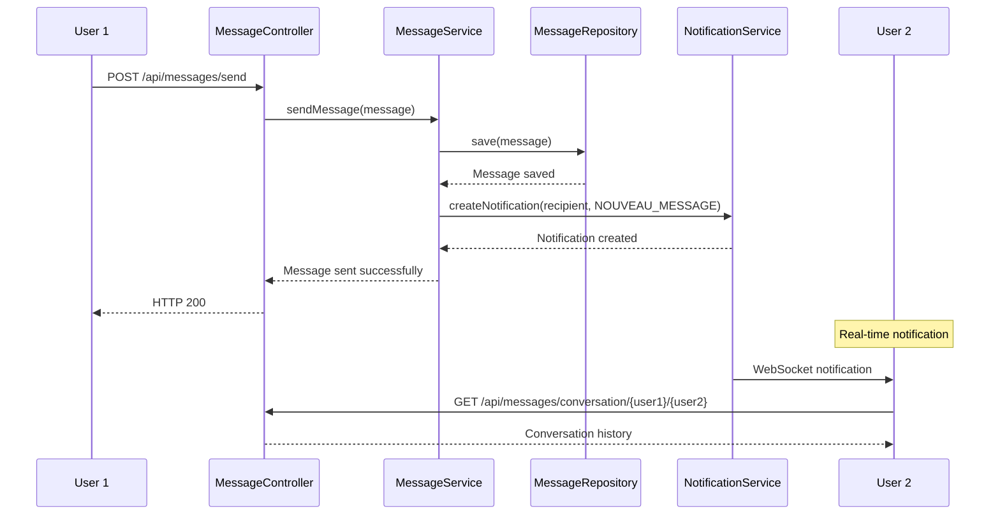

# 🏢 PORTAL CABINET COMPTABLE - PROJECT REFERENCE SUMMARY

## 📋 PROJECT OVERVIEW

**Project Name:** Portail Cabinet Comptable (Accounting Firm Portal)  
**Type:** Web Application - Backend Spring Boot + Frontend Angular (planned)  
**Purpose:** Digital platform for accounting firms to manage client interactions, document exchange, and communication  
**Status:** Backend Development Phase 1 Complete  
**Repository:** https://github.com/yasserbenhadda/portail-cabinet-comptable  
**Branch:** `backend` (current development)

---

## 🎯 BUSINESS LOGIC & OBJECTIVES

### **Primary Business Goals**
1. **Digitalize Client-Cabinet Exchanges** - Replace paper-based document exchange with secure digital platform
2. **Centralize Communication** - Provide unified messaging system between accountants and clients
3. **Automate Document Processing** - AI-powered document analysis and validation
4. **Enhance Client Experience** - Modern, user-friendly interface for document submission and tracking
5. **Improve Operational Efficiency** - Streamline workflows and reduce manual processing time

### **Target Users & Roles**

#### **👥 CLIENT (Role: CLIENT)**
**Capabilities:**
- Upload documents (invoices, receipts, financial statements)
- View document status (deposited, validated, rejected)
- Send/receive messages with accountants
- Access document history and archives
- Receive real-time notifications
- Use AI chatbot for document-related questions

**Business Value:** Self-service portal reduces dependency on phone/email communication

#### **📊 ACCOUNTANT (Role: COMPTABLE)**
**Capabilities:**
- Review and validate client documents
- Reject documents with reasons
- Send messages to clients
- Access all client documents and history
- Use AI tools for document analysis
- Generate reports and statistics
- Manage document workflows

**Business Value:** Efficient document processing and client management

#### **⚙️ ADMINISTRATOR (Role: ADMIN)**
**Capabilities:**
- Manage all user accounts (clients, accountants)
- Monitor system statistics and usage
- Configure system settings
- Access audit logs
- Manage document storage and retention
- Oversee AI chatbot configuration

**Business Value:** Complete system administration and oversight

---

## 🏗️ TECHNICAL ARCHITECTURE

### **Technology Stack**
- **Backend:** Spring Boot 3.2+, Java 17
- **Database:** PostgreSQL 12+
- **Authentication:** JWT (JSON Web Tokens)
- **Security:** Spring Security, BCrypt
- **Build Tool:** Maven
- **Frontend:** Angular (planned)
- **File Storage:** Local file system (configurable)

### **Architecture Pattern**
```
┌─────────────────────────────────────────────────────────────────────────────┐
│                              LAYERED ARCHITECTURE                           │
├─────────────────────────────────────────────────────────────────────────────┤
│                                                                             │
│  ┌─────────────────────────────────────────────────────────────────────┐   │
│  │                    PRESENTATION LAYER                              │   │
│  │  ┌─────────────┐ ┌─────────────┐ ┌─────────────┐ ┌─────────────┐   │   │
│  │  │AuthController│ │UserController│ │DocController│ │MsgController│   │   │
│  │  └─────────────┘ └─────────────┘ └─────────────┘ └─────────────┘   │   │
│  └─────────────────────────────────────────────────────────────────────┘   │
│                                    │                                       │
│                                    ▼                                       │
│  ┌─────────────────────────────────────────────────────────────────────┐   │
│  │                     BUSINESS LAYER                                 │   │
│  │  ┌─────────────┐ ┌─────────────┐ ┌─────────────┐ ┌─────────────┐   │   │
│  │  │ AuthService │ │ UserService │ │ DocService  │ │ MsgService  │   │   │
│  │  └─────────────┘ └─────────────┘ └─────────────┘ └─────────────┘   │   │
│  └─────────────────────────────────────────────────────────────────────┘   │
│                                    │                                       │
│                                    ▼                                       │
│  ┌─────────────────────────────────────────────────────────────────────┐   │
│  │                     DATA ACCESS LAYER                              │   │
│  │  ┌─────────────┐ ┌─────────────┐ ┌─────────────┐ ┌─────────────┐   │   │
│  │  │UserRepository│ │DocRepository│ │MsgRepository│ │NotifRepository│   │   │
│  │  └─────────────┘ └─────────────┘ └─────────────┘ └─────────────┘   │   │
│  └─────────────────────────────────────────────────────────────────────┘   │
│                                    │                                       │
│                                    ▼                                       │
│  ┌─────────────────────────────────────────────────────────────────────┐   │
│  │                      DATABASE LAYER                                │   │
│  │                        PostgreSQL                                  │   │
│  └─────────────────────────────────────────────────────────────────────┘   │
└─────────────────────────────────────────────────────────────────────────────┘
```

---

## 📊 DATA MODEL & ENTITIES

### **Core Entities**

#### **👤 User Entity**
```java
@Entity
public class User {
    @Id @GeneratedValue(strategy = GenerationType.IDENTITY)
    private Long id;
    
    @NotBlank @Email
    private String email;                    // Primary identifier
    
    @NotBlank
    private String motDePasse;               // BCrypt hashed
    
    @NotBlank @Size(min = 2, max = 50)
    private String nom;
    
    @NotBlank @Size(min = 2, max = 50)
    private String prenom;
    
    @Enumerated(EnumType.STRING)
    private UserRole role;                   // CLIENT, COMPTABLE, ADMIN
    
    private boolean enabled = true;
    
    @Column(name = "date_creation")
    private LocalDateTime dateCreation;
    
    @Column(name = "date_modification")
    private LocalDateTime dateModification;
}
```

#### **📄 Document Entity**
```java
@Entity
public class Document {
    @Id @GeneratedValue(strategy = GenerationType.IDENTITY)
    private Long id;
    
    @NotBlank
    private String nomFichier;               // Original filename
    
    private String cheminFichier;            // Physical file path
    
    @Enumerated(EnumType.STRING)
    private DocumentStatut statut;           // DEPOSE, VALIDE, REJETE
    
    private String type;                     // PDF, IMAGE, WORD, EXCEL, etc.
    
    private Long tailleFichier;              // File size in bytes
    
    @ManyToOne @JoinColumn(name = "expediteur_id")
    private User expediteur;                 // Document sender
    
    @ManyToOne @JoinColumn(name = "destinataire_id")
    private User destinataire;               // Document recipient
    
    private String description;
    
    @Column(name = "date_depot")
    private LocalDateTime dateDepot;
}
```

#### **💬 Message Entity**
```java
@Entity
public class Message {
    @Id @GeneratedValue(strategy = GenerationType.IDENTITY)
    private Long id;
    
    @ManyToOne @JoinColumn(name = "expediteur_id")
    private User expediteur;
    
    @ManyToOne @JoinColumn(name = "destinataire_id")
    private User destinataire;
    
    @NotBlank
    private String contenu;
    
    @Enumerated(EnumType.STRING)
    private MessageStatut statut;            // ENVOYE, RECU, LU
    
    @Column(name = "date_envoi")
    private LocalDateTime dateEnvoi;
    
    private boolean lu = false;
}
```

#### **🔔 Notification Entity**
```java
@Entity
public class Notification {
    @Id @GeneratedValue(strategy = GenerationType.IDENTITY)
    private Long id;
    
    @ManyToOne @JoinColumn(name = "destinataire_id")
    private User destinataire;
    
    @Enumerated(EnumType.STRING)
    private NotificationType type;           // NOUVEAU_DOCUMENT, MESSAGE, etc.
    
    private String contenu;
    
    private boolean lu = false;
    
    @Column(name = "date_creation")
    private LocalDateTime dateCreation;
}
```

#### **🤖 ChatBotAI Entity**
```java
@Entity
public class ChatBotAI {
    @Id @GeneratedValue(strategy = GenerationType.IDENTITY)
    private Long id;
    
    @ManyToOne @JoinColumn(name = "user_id")
    private User user;
    
    private String question;
    
    private String reponse;
    
    @Enumerated(EnumType.STRING)
    private TypeAnalyse typeAnalyse;         // EXTRACTION_INFO, VERIFICATION, etc.
    
    @Column(name = "date_creation")
    private LocalDateTime dateCreation;
}
```

---

## 🔄 BUSINESS FLOWS & WORKFLOWS

### **1. Document Upload & Validation Flow**


### **2. Authentication & Authorization Flow**


### **3. Messaging System Flow**


---

## 🔐 SECURITY & ACCESS CONTROL

### **Role-Based Access Control (RBAC)**

#### **🔓 Public Endpoints (No Authentication)**
- `POST /api/auth/login` - User login
- `POST /api/auth/register` - User registration
- `POST /api/auth/refresh` - Token refresh
- `GET /api/auth/validate` - Token validation

#### **👤 CLIENT Permissions**
- **Documents:** Upload, view own documents, download own documents
- **Messages:** Send/receive messages with assigned accountants
- **Profile:** View and update own profile
- **Notifications:** View own notifications

#### **📊 COMPTABLE Permissions**
- **Documents:** View all client documents, validate/reject documents
- **Messages:** Send/receive messages with all clients
- **Users:** View client profiles and information
- **Reports:** Access basic statistics and reports
- **Notifications:** View all notifications

#### **⚙️ ADMIN Permissions**
- **Users:** Full CRUD operations on all users
- **System:** Access to all endpoints and data
- **Configuration:** System settings and configuration
- **Monitoring:** Complete system statistics and logs

### **Security Features**
- **JWT Authentication** - Stateless token-based authentication
- **Password Hashing** - BCrypt for secure password storage
- **Input Validation** - Bean validation on all DTOs
- **CORS Configuration** - Cross-origin resource sharing setup
- **File Upload Security** - File type and size validation
- **SQL Injection Protection** - JPA/Hibernate parameterized queries

---

## 📁 CURRENT IMPLEMENTATION STATUS

### **✅ COMPLETED COMPONENTS**

#### **🏗️ Core Infrastructure**
- ✅ **Project Structure** - Complete Maven project with proper package organization
- ✅ **Configuration** - `application.yml` with database, JWT, and file upload settings
- ✅ **Dependencies** - All required Spring Boot dependencies in `pom.xml`

#### **📊 Data Layer**
- ✅ **Entities** - All JPA entities with proper annotations and relationships
- ✅ **Repositories** - JPA repositories with custom query methods
- ✅ **Database Schema** - PostgreSQL schema design with indexes

#### **🔧 Business Logic Layer**
- ✅ **AuthService** - Complete JWT authentication and token management
- ✅ **UserService** - User CRUD operations and profile management
- ✅ **DocumentService** - File upload, download, and document management
- ✅ **Service Interfaces** - All service contracts defined

#### **🌐 API Layer**
- ✅ **AuthController** - Authentication endpoints (login, register, refresh)
- ✅ **UserController** - User management endpoints
- ✅ **DocumentController** - Document upload/download/management endpoints

#### **📝 Documentation**
- ✅ **README.md** - Comprehensive project documentation
- ✅ **Architecture Documentation** - Complete technical documentation
- ✅ **API Documentation** - Endpoint descriptions and examples

### **🚧 IN PROGRESS / NEXT PHASE**

#### **🔐 Security Implementation**
- ⏳ **Spring Security Configuration** - JWT filter and security rules
- ⏳ **Role-Based Authorization** - Endpoint protection by user roles
- ⏳ **CORS Configuration** - Cross-origin setup for frontend

#### **💬 Messaging System**
- ⏳ **MessageService Implementation** - Message sending and conversation management
- ⏳ **MessageController** - REST endpoints for messaging
- ⏳ **Real-time Notifications** - WebSocket implementation

#### **🔔 Notification System**
- ⏳ **NotificationService Implementation** - Notification creation and management
- ⏳ **NotificationController** - Notification endpoints
- ⏳ **Notification Types** - Different notification categories

#### **🤖 AI ChatBot**
- ⏳ **ChatBotService Implementation** - AI integration for document analysis
- ⏳ **ChatBotController** - AI interaction endpoints
- ⏳ **Document Analysis** - AI-powered document processing

#### **📊 Admin Dashboard**
- ⏳ **AdminController** - Administrative endpoints and statistics
- ⏳ **Reporting System** - Business intelligence and analytics
- ⏳ **System Monitoring** - Performance and usage metrics

---

## 🎯 BUSINESS RULES & VALIDATIONS

### **Document Management Rules**
1. **File Type Validation** - Only allowed extensions: PDF, JPG, PNG, DOC, DOCX, XLS, XLSX, TXT
2. **File Size Limit** - Maximum 10MB per file
3. **Document Status Workflow** - DEPOSE → VALIDE/REJETE (by accountant)
4. **Access Control** - Users can only access their own documents or documents assigned to them

### **User Management Rules**
1. **Email Uniqueness** - Each email can only be registered once
2. **Password Requirements** - Minimum 8 characters, BCrypt hashing
3. **Role Assignment** - Only admins can change user roles
4. **Account Status** - Users can be enabled/disabled by admins

### **Messaging Rules**
1. **Conversation Privacy** - Users can only see conversations they're part of
2. **Message Status Tracking** - ENVOYE → RECU → LU
3. **Real-time Notifications** - Immediate notification on new messages

### **Security Rules**
1. **JWT Expiration** - 24 hours for access tokens, 7 days for refresh tokens
2. **Password Security** - BCrypt with salt rounds
3. **Input Sanitization** - All user inputs validated and sanitized
4. **File Upload Security** - Virus scanning and type validation

---

## 🔧 TECHNICAL SPECIFICATIONS

### **API Endpoints Summary**

#### **Authentication (`/api/auth`)**
- `POST /login` - User authentication
- `POST /register` - User registration
- `POST /refresh` - Token refresh
- `POST /logout` - User logout
- `GET /validate` - Token validation

#### **Users (`/api/users`)**
- `GET /profile/{id}` - Get user profile
- `PUT /profile/{id}` - Update user profile
- `GET /clients` - List all clients
- `GET /admins` - List all administrators
- `POST /` - Create new user
- `DELETE /{id}` - Delete user

#### **Documents (`/api/documents`)**
- `POST /upload` - Upload document
- `GET /download/{id}` - Download document
- `GET /user/{userId}` - Get user documents
- `PUT /{id}/validate` - Validate document
- `PUT /{id}/reject` - Reject document
- `DELETE /{id}` - Delete document

#### **Messages (`/api/messages`)**
- `POST /send` - Send message
- `GET /conversation/{user1}/{user2}` - Get conversation
- `GET /user/{userId}` - Get user messages
- `PUT /{id}/read` - Mark as read

#### **Notifications (`/api/notifications`)**
- `GET /user/{userId}` - Get user notifications
- `PUT /{id}/read` - Mark as read
- `DELETE /{id}` - Delete notification

#### **ChatBot (`/api/chatbot`)**
- `POST /analyze` - Analyze document
- `POST /question` - Ask question
- `GET /history/{userId}` - Get AI history

#### **Admin (`/api/admin`)**
- `GET /statistics` - System statistics
- `GET /users/overview` - User overview
- `GET /documents/overview` - Document overview

### **Database Configuration**
```yaml
spring:
  datasource:
    url: jdbc:postgresql://localhost:5432/portail_cabinet
    username: postgres
    password: password
    driver-class-name: org.postgresql.Driver
    
  jpa:
    hibernate:
      ddl-auto: update
    show-sql: true
    properties:
      hibernate:
        dialect: org.hibernate.dialect.PostgreSQLDialect
        format_sql: true
```

### **JWT Configuration**
```yaml
jwt:
  secret: votre_secret_jwt_tres_securise_et_complexe_pour_la_production
  expiration: 86400000  # 24 hours
  refresh-expiration: 604800000  # 7 days
```

---

## 🚀 DEPLOYMENT & ENVIRONMENT

### **Development Environment**
- **Java:** 17+
- **Maven:** 3.6+
- **PostgreSQL:** 12+
- **IDE:** IntelliJ IDEA, Eclipse, VS Code
- **Port:** 8080

### **Production Considerations**
- **Database:** PostgreSQL with connection pooling
- **File Storage:** Configurable (local filesystem or cloud storage)
- **Security:** HTTPS, strong JWT secrets, environment variables
- **Monitoring:** Application logs, database monitoring
- **Backup:** Database and file storage backup strategies

### **Environment Variables**
```bash
# Database
DB_HOST=localhost
DB_PORT=5432
DB_NAME=portail_cabinet
DB_USERNAME=postgres
DB_PASSWORD=password

# JWT
JWT_SECRET=your_secure_jwt_secret
JWT_EXPIRATION=86400000

# File Upload
UPLOAD_DIR=./uploads/documents
MAX_FILE_SIZE=10485760
```

---

## 📈 FUTURE ROADMAP

### **Phase 2: Security & Messaging**
- [ ] Spring Security configuration
- [ ] Message service implementation
- [ ] Real-time notifications (WebSocket)
- [ ] Notification system

### **Phase 3: AI Integration**
- [ ] ChatBot service implementation
- [ ] Document analysis AI
- [ ] Question-answering system
- [ ] AI-powered suggestions

### **Phase 4: Admin Dashboard**
- [ ] Admin controller and endpoints
- [ ] Statistics and reporting
- [ ] System monitoring
- [ ] User management interface

### **Phase 5: Frontend Development**
- [ ] Angular application setup
- [ ] User interface components
- [ ] Real-time features
- [ ] Responsive design

### **Phase 6: Advanced Features**
- [ ] Multi-tenant architecture
- [ ] Advanced AI features
- [ ] Mobile application
- [ ] API documentation (Swagger)

---

## 🔍 TROUBLESHOOTING & COMMON ISSUES

### **Common Development Issues**
1. **Database Connection** - Verify PostgreSQL is running and credentials are correct
2. **JWT Token Issues** - Check JWT secret configuration and token expiration
3. **File Upload Problems** - Verify upload directory permissions and file size limits
4. **CORS Issues** - Configure CORS for frontend integration

### **Performance Considerations**
1. **Database Indexing** - Ensure proper indexes on frequently queried columns
2. **File Storage** - Consider cloud storage for production scalability
3. **Connection Pooling** - Configure HikariCP for optimal database performance
4. **Caching** - Implement caching for frequently accessed data

### **Security Best Practices**
1. **Environment Variables** - Never commit secrets to version control
2. **Input Validation** - Validate all user inputs
3. **File Upload Security** - Implement virus scanning and type validation
4. **Regular Updates** - Keep dependencies updated for security patches

---

## 📞 SUPPORT & RESOURCES

### **Documentation**
- **Project README:** `README.md`
- **Architecture Docs:** `Architecture et Rôle des Dossiers/`
- **API Documentation:** Planned Swagger integration

### **Repository Structure**
```
portail-cabinet-comptable/
├── 📖 README.md                              # Project documentation
├── 📋 pom.xml                                # Maven configuration
├── 📁 src/main/java/com/cabinet/portail/
│   ├── 🏗️ entity/                           # JPA entities
│   ├── 📦 repository/                        # Data access layer
│   ├── 📦 service/                           # Business logic
│   ├── 📦 controller/                        # REST controllers
│   ├── 📦 dto/                               # Data transfer objects
│   ├── 🔒 security/                          # Security configuration
│   ├── ⚙️ config/                            # Application config
│   ├── ⚠️ exception/                         # Error handling
│   ├── 🛠️ util/                              # Utilities
│   └── 🚀 PortailApplication.java            # Main class
├── 📁 src/main/resources/
│   └── ⚙️ application.yml                    # Configuration
├── 📁 Architecture et Rôle des Dossiers/     # Technical docs
└── 📁 uploads/                               # File storage
```

### **Key Contacts**
- **Repository:** https://github.com/yasserbenhadda/portail-cabinet-comptable
- **Current Branch:** `backend`
- **Development Status:** Phase 1 Complete, Phase 2 In Progress

---

*This reference summary provides a complete overview of the Portail Cabinet Comptable project. Use this document to quickly understand the project structure, business logic, technical implementation, and development status when resuming work on the project.* 